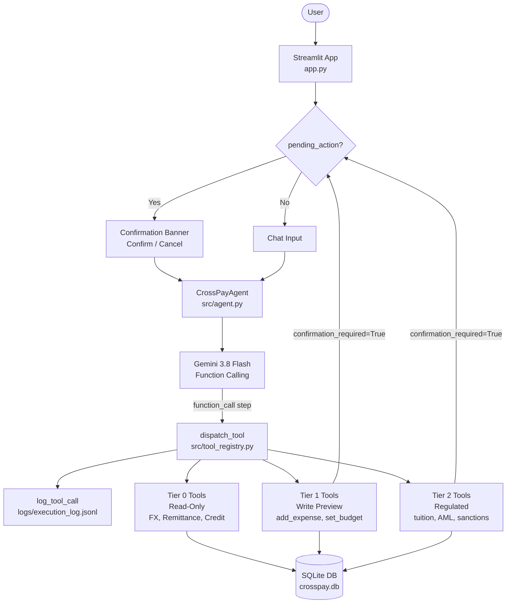

# CrossPay System Architecture

## ASCII Overview

```
╔══════════════════════════════════════════════════════════════════╗
║                 CrossPay Architecture                            ║
╠══════════════════════════════════════════════════════════════════╣
║                                                                  ║
║  ┌──────────────────────────────────────────────────────────┐   ║
║  │              PRESENTATION LAYER                           │   ║
║  │  app.py (Streamlit)  +  src/ui_components.py             │   ║
║  │  • Chat interface    • Sidebar (stats, quick actions)    │   ║
║  │  • Confirmation banner (Confirm/Cancel buttons)          │   ║
║  └─────────────────────────┬────────────────────────────────┘   ║
║                            │                                     ║
║  ┌─────────────────────────▼────────────────────────────────┐   ║
║  │                 AGENT LAYER                               │   ║
║  │  src/agent.py — CrossPayAgent                            │   ║
║  │  • Gemini 3.8 Flash (function-calling)                   │   ║
║  │  • Stateful: previous_interaction_id                     │   ║
║  │  • Tool call loop + confirmation gate                    │   ║
║  └────────┬─────────────────────────────┬────────────────────┘   ║
║           │                             │                        ║
║  ┌────────▼──────────┐      ┌───────────▼────────────────────┐   ║
║  │  GEMINI API       │      │  TOOL REGISTRY                 │   ║
║  │  gemini-3.8-flash │      │  src/tool_registry.py          │   ║
║  │  (LLM reasoning,  │      │  • TOOL_DECLARATIONS (10 tools)│   ║
║  │   function calls) │      │  • dispatch_tool() router      │   ║
║  └───────────────────┘      └───────────┬────────────────────┘   ║
║                                         │                        ║
║  ┌──────────────────────────────────────▼─────────────────────┐  ║
║  │                    TOOLS LAYER                              │  ║
║  │  src/tools/                                                 │  ║
║  │  ┌──────────┐ ┌───────────┐ ┌────────┐ ┌───────────────┐  │  ║
║  │  │  fx.py   │ │remittance │ │budget  │ │  compliance   │  │  ║
║  │  │ FX rates │ │ .py       │ │ .py    │ │   .py         │  │  ║
║  │  │ convert  │ │ compare   │ │ track  │ │ AML│sanctions │  │  ║
║  │  └──────────┘ └───────────┘ └────────┘ │ PII masking  │  │  ║
║  │  ┌──────────┐                           └───────────────┘  │  ║
║  │  │credit.py │                                               │  ║
║  │  │ profile  │                                               │  ║
║  │  │ simulate │                                               │  ║
║  │  └──────────┘                                               │  ║
║  └──────────────────────────────┬──────────────────────────────┘  ║
║                                 │                                 ║
║  ┌──────────────────────────────▼──────────────────────────────┐  ║
║  │               DATA & AUDIT LAYER                             │  ║
║  │  src/logger.py          src/db.py                           │  ║
║  │  logs/execution_log.jsonl    data/crosspay.db (SQLite)      │  ║
║  │  (PII-masked audit trail)    (accounts, expenses, budgets)  │  ║
║  └─────────────────────────────────────────────────────────────┘  ║
╚══════════════════════════════════════════════════════════════════╝
```

## Mermaid Diagram


